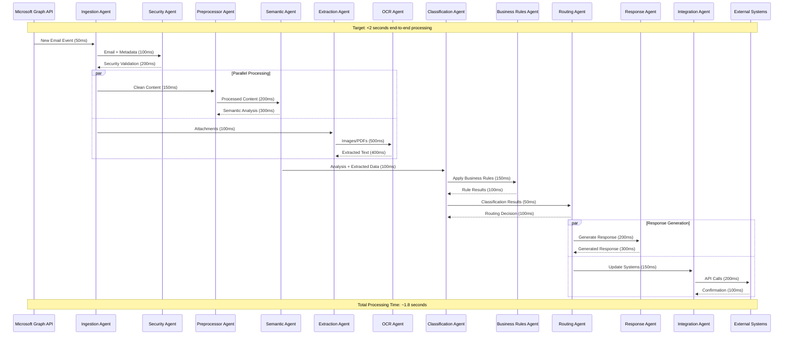

# Design Document - Plateforme d'Automatisation Intelligente d'Emails

## Overview

La plateforme d'automatisation intelligente d'emails adopte une architecture agentic-first basée sur OpenAI Agents SDK. Le système est conçu autour d'agents autonomes spécialisés qui collaborent pour traiter les emails de manière intelligente et automatisée. L'architecture privilégie la modularité, la scalabilité et la maintenabilité à travers une orchestration d'agents avec des responsabilités bien définies.

### Paradigme Agentic-First

Le système utilise un paradigme où chaque fonction métier est implémentée par un agent autonome avec :
- **Rôles fonctionnels spécifiques** : Chaque agent a une responsabilité claire et délimitée
- **Interfaces typées** : Communication via des inputs/outputs structurés et typés
- **Tools dédiés** : Chaque agent dispose d'outils spécialisés pour ses tâches
- **Handoffs structurés** : Transferts de contexte entre agents avec validation
- **Mécanismes de fallback** : Gestion d'erreurs et récupération automatique

## Architecture

### Vue d'Ensemble du Système - Architecture Complète

```mermaid
graph TB
    subgraph "External Email Sources"
        O365[Office 365 Mailboxes]
        Exchange[Exchange Online]
        Outlook[Outlook Web App]
    end
    
    subgraph "Ingestion & Security Layer"
        GraphAPI[Microsoft Graph API Client]
        Webhook[Graph Change Notifications]
        AuthService[OAuth2 Authentication Service]
        RateLimiter[API Rate Limiter]
        
        subgraph "Security Validation Pipeline"
            SecurityAgent[Security Validation Agent]
            DKIMValidator[DKIM Validator Tool]
            SPFChecker[SPF Checker Tool]
            AntiSpam[Anti-Spam Engine Tool]
            PhishingDetector[Phishing Detector Tool]
            ReputationChecker[Reputation Checker Tool]
        end
    end
    
    subgraph "AI Processing Pipeline - Near Real-Time"
        subgraph "Content Analysis Cluster"
            IngestionAgent[Email Ingestion Agent]
            PreprocessorAgent[Content Preprocessor Agent]
            LanguageDetector[Language Detection Tool]
            ContentCleaner[HTML Cleaner Tool]
            MetadataExtractor[Metadata Extractor Tool]
        end
        
        subgraph "Semantic Intelligence Cluster"
            SemanticAgent[Semantic Analysis Agent]
            NLPEngine[NLP Processing Tool]
            EntityRecognizer[Named Entity Recognition Tool]
            IntentClassifier[Intent Classification Tool]
            SentimentAnalyzer[Sentiment Analysis Tool]
            ContextAnalyzer[Context Understanding Tool]
        end
        
        subgraph "Data Extraction Cluster"
            ExtractionAgent[Data Extraction Agent]
            OCRAgent[OCR Processing Agent]
            DocumentParser[Document Parser Agent]
            OCREngine[Tesseract/Azure OCR Tool]
            PDFParser[PDF Parser Tool]
            ImageProcessor[Image Processing Tool]
            TemplateMatcher[Template Matching Tool]
            FormProcessor[Form Processing Tool]
            DataValidator[Data Validation Tool]
        end
        
        subgraph "Classification & Routing Cluster"
            ClassificationAgent[Email Classification Agent]
            BusinessRulesAgent[Business Rules Agent]
            PriorityAgent[Priority Scoring Agent]
            MLClassifier[ML Classification Tool]
            RulesEngine[Business Rules Engine Tool]
            ConfidenceScorer[Confidence Scoring Tool]
            
            RoutingAgent[Intelligent Routing Agent]
            SkillsMatcher[Skills Matching Tool]
            WorkloadBalancer[Workload Balancer Tool]
            SLACalculator[SLA Calculator Tool]
            EscalationEngine[Escalation Engine Tool]
            AvailabilityChecker[Availability Checker Tool]
        end
        
        subgraph "Response Generation Cluster"
            ResponseAgent[Response Generation Agent]
            TemplateAgent[Template Selection Agent]
            PersonalizationAgent[Personalization Agent]
            LLMGenerator[LLM Response Generator Tool]
            TemplateEngine[Template Engine Tool]
            ToneAdapter[Tone Adaptation Tool]
            ContentValidator[Content Validator Tool]
        end
        
        subgraph "Integration & Delivery Cluster"
            IntegrationAgent[System Integration Agent]
            CRMAgent[CRM Integration Agent]
            ERPAgent[ERP Integration Agent]
            TicketingAgent[Ticketing Integration Agent]
            NotificationAgent[Notification Agent]
        end
    end
    
    subgraph "Orchestration & Control Layer"
        Portal[OpenAI Compatible Agent Portal]
        Airflow[Apache Airflow Orchestrator]
        MessageBroker[Redis Message Broker]
        EventBus[Event Bus System]
        WorkflowEngine[Workflow Engine]
        
        subgraph "Monitoring & Control Agents"
            MonitoringAgent[System Monitoring Agent]
            HealthChecker[Health Check Tool]
            MetricsCollector[Metrics Collector Tool]
            AlertManager[Alert Manager Tool]
            
            AuditAgent[Audit & Compliance Agent]
            AuditLogger[Audit Logger Tool]
            ComplianceChecker[Compliance Checker Tool]
            DataGovernance[Data Governance Tool]
            
            LoadBalancerAgent[Load Balancer Agent]
            ResourceManager[Resource Manager Tool]
            ScalingController[Auto-Scaling Controller Tool]
        end
    end
    
    subgraph "Data & Storage Layer"
        subgraph "Primary Storage"
            EmailStore[(PostgreSQL Email Store)]
            MetadataStore[(MongoDB Metadata Store)]
            AttachmentStore[(Azure Blob Attachment Store)]
        end
        
        subgraph "Caching & Performance"
            RedisCache[(Redis Cache Cluster)]
            SessionStore[(Session Store)]
            TempStorage[(Temporary Processing Storage)]
        end
        
        subgraph "ML & AI Models"
            MLModels[(ML Model Store)]
            VectorDB[(Vector Database - Pinecone)]
            EmbeddingStore[(Embedding Store)]
            ModelRegistry[(Model Registry)]
        end
        
        subgraph "Configuration & Rules"
            RulesDB[(Business Rules DB)]
            ConfigStore[(Configuration Store)]
            TenantConfig[(Tenant Configuration)]
            UserPreferences[(User Preferences)]
        end
    end
    
    subgraph "External Systems Integration"
        subgraph "CRM Systems"
            Salesforce[Salesforce CRM]
            HubSpot[HubSpot CRM]
            Dynamics[Microsoft Dynamics]
        end
        
        subgraph "ERP Systems"
            SAP[SAP ERP]
            Oracle[Oracle ERP]
            NetSuite[NetSuite ERP]
        end
        
        subgraph "Ticketing & Support"
            Jira[Jira Service Desk]
            ServiceNow[ServiceNow]
            Zendesk[Zendesk]
            Freshdesk[Freshdesk]
        end
        
        subgraph "Communication & Notifications"
            SMTP[SMTP Server]
            Teams[Microsoft Teams]
            Slack[Slack]
            SMS[SMS Gateway]
        end
        
        subgraph "Identity & Security"
            ActiveDirectory[Active Directory]
            AzureAD[Azure Active Directory]
            LDAP[LDAP Server]
            SSO[SSO Provider]
        end
    end
    
    %% Data Flow Connections
    O365 --> GraphAPI
    Exchange --> GraphAPI
    Outlook --> GraphAPI
    
    GraphAPI --> AuthService
    AuthService --> RateLimiter
    RateLimiter --> IngestionAgent
    Webhook --> IngestionAgent
    
    IngestionAgent --> SecurityAgent
    SecurityAgent --> PreprocessorAgent
    PreprocessorAgent --> SemanticAgent
    
    SemanticAgent --> ExtractionAgent
    SemanticAgent --> OCRAgent
    SemanticAgent --> DocumentParser
    
    ExtractionAgent --> ClassificationAgent
    OCRAgent --> ExtractionAgent
    DocumentParser --> ExtractionAgent
    
    ClassificationAgent --> BusinessRulesAgent
    BusinessRulesAgent --> PriorityAgent
    PriorityAgent --> RoutingAgent
    
    RoutingAgent --> ResponseAgent
    ResponseAgent --> TemplateAgent
    TemplateAgent --> PersonalizationAgent
    PersonalizationAgent --> IntegrationAgent
    
    IntegrationAgent --> CRMAgent
    IntegrationAgent --> ERPAgent
    IntegrationAgent --> TicketingAgent
    IntegrationAgent --> NotificationAgent
    
    %% Orchestration Connections
    Portal --> Airflow
    Airflow --> MessageBroker
    MessageBroker --> EventBus
    EventBus --> WorkflowEngine
    
    %% Storage Connections
    IngestionAgent --> EmailStore
    SemanticAgent --> MetadataStore
    ExtractionAgent --> AttachmentStore
    ClassificationAgent --> RulesDB
    ResponseAgent --> MLModels
    
    %% Cache Connections
    SemanticAgent --> RedisCache
    ClassificationAgent --> RedisCache
    RoutingAgent --> RedisCache
    ResponseAgent --> RedisCache
    
    %% External System Connections
    CRMAgent --> Salesforce
    CRMAgent --> HubSpot
    CRMAgent --> Dynamics
    
    ERPAgent --> SAP
    ERPAgent --> Oracle
    ERPAgent --> NetSuite
    
    TicketingAgent --> Jira
    TicketingAgent --> ServiceNow
    TicketingAgent --> Zendesk
    TicketingAgent --> Freshdesk
    
    NotificationAgent --> SMTP
    NotificationAgent --> Teams
    NotificationAgent --> Slack
    NotificationAgent --> SMS
    
    %% Monitoring Connections
    MonitoringAgent --> RedisCache
    AuditAgent --> MetadataStore
    LoadBalancerAgent --> EventBus
```



### Architecture Multi-Tenant avec Isolation Complète

```mermaid
graph TB
    subgraph "Load Balancer & Tenant Routing"
        LoadBalancer[Application Load Balancer]
        TenantRouter[Tenant Identification Router]
        TenantAuth[Tenant Authentication Service]
        TenantRegistry[(Tenant Registry)]
    end
    
    subgraph "Tenant A - Organization Alpha"
        subgraph "Agent Cluster A"
            IngestionA[Ingestion Agent A]
            SemanticA[Semantic Agent A]
            ExtractionA[Extraction Agent A]
            ClassificationA[Classification Agent A]
            RoutingA[Routing Agent A]
            ResponseA[Response Agent A]
            IntegrationA[Integration Agent A]
        end
        
        subgraph "Data Isolation A"
            EmailStoreA[(Email Store A)]
            MetadataA[(Metadata A)]
            RulesA[(Business Rules A)]
            ConfigA[(Config A)]
            UsersA[(Users A)]
            AuditA[(Audit Logs A)]
        end
        
        subgraph "Custom Integrations A"
            CRMA[CRM A - Salesforce]
            ERPA[ERP A - SAP]
            TicketingA[Ticketing A - Jira]
        end
    end
    
    subgraph "Tenant B - Organization Beta"
        subgraph "Agent Cluster B"
            IngestionB[Ingestion Agent B]
            SemanticB[Semantic Agent B]
            ExtractionB[Extraction Agent B]
            ClassificationB[Classification Agent B]
            RoutingB[Routing Agent B]
            ResponseB[Response Agent B]
            IntegrationB[Integration Agent B]
        end
        
        subgraph "Data Isolation B"
            EmailStoreB[(Email Store B)]
            MetadataB[(Metadata B)]
            RulesB[(Business Rules B)]
            ConfigB[(Config B)]
            UsersB[(Users B)]
            AuditB[(Audit Logs B)]
        end
        
        subgraph "Custom Integrations B"
            CRMB[CRM B - HubSpot]
            ERPB[ERP B - Oracle]
            TicketingB[Ticketing B - ServiceNow]
        end
    end
    
    subgraph "Tenant C - Organization Gamma"
        subgraph "Agent Cluster C"
            IngestionC[Ingestion Agent C]
            SemanticC[Semantic Agent C]
            ExtractionC[Extraction Agent C]
            ClassificationC[Classification Agent C]
            RoutingC[Routing Agent C]
            ResponseC[Response Agent C]
            IntegrationC[Integration Agent C]
        end
        
        subgraph "Data Isolation C"
            EmailStoreC[(Email Store C)]
            MetadataC[(Metadata C)]
            RulesC[(Business Rules C)]
            ConfigC[(Config C)]
            UsersC[(Users C)]
            AuditC[(Audit Logs C)]
        end
        
        subgraph "Custom Integrations C"
            CRMC[CRM C - Dynamics]
            ERPC[ERP C - NetSuite]
            TicketingC[Ticketing C - Zendesk]
        end
    end
    
    subgraph "Shared Platform Services"
        subgraph "Shared ML & AI"
            SharedMLModels[(Shared ML Models)]
            VectorDatabase[(Vector Database)]
            EmbeddingService[Embedding Service]
            ModelTraining[Model Training Service]
        end
        
        subgraph "Shared Infrastructure"
            SharedCache[(Redis Cluster)]
            MessageBroker[Message Broker]
            EventBus[Event Bus]
            MonitoringService[Global Monitoring]
            LoggingService[Centralized Logging]
        end
        
        subgraph "Platform Management"
            TenantManager[Tenant Management Service]
            BillingService[Billing & Usage Service]
            BackupService[Backup & Recovery Service]
            SecurityService[Security & Compliance Service]
        end
    end
    
    subgraph "Network & Security Layer"
        VPN[VPN Gateway]
        Firewall[Web Application Firewall]
        DDoSProtection[DDoS Protection]
        SSLTermination[SSL Termination]
    end
    
    %% Routing Connections
    LoadBalancer --> TenantRouter
    TenantRouter --> TenantAuth
    TenantAuth --> TenantRegistry
    
    TenantRouter --> IngestionA
    TenantRouter --> IngestionB
    TenantRouter --> IngestionC
    
    %% Tenant A Flow
    IngestionA --> SemanticA
    SemanticA --> ExtractionA
    ExtractionA --> ClassificationA
    ClassificationA --> RoutingA
    RoutingA --> ResponseA
    ResponseA --> IntegrationA
    
    IngestionA --> EmailStoreA
    SemanticA --> MetadataA
    ClassificationA --> RulesA
    IntegrationA --> CRMA
    IntegrationA --> ERPA
    IntegrationA --> TicketingA
    
    %% Tenant B Flow
    IngestionB --> SemanticB
    SemanticB --> ExtractionB
    ExtractionB --> ClassificationB
    ClassificationB --> RoutingB
    RoutingB --> ResponseB
    ResponseB --> IntegrationB
    
    IngestionB --> EmailStoreB
    SemanticB --> MetadataB
    ClassificationB --> RulesB
    IntegrationB --> CRMB
    IntegrationB --> ERPB
    IntegrationB --> TicketingB
    
    %% Tenant C Flow
    IngestionC --> SemanticC
    SemanticC --> ExtractionC
    ExtractionC --> ClassificationC
    ClassificationC --> RoutingC
    RoutingC --> ResponseC
    ResponseC --> IntegrationC
    
    IngestionC --> EmailStoreC
    SemanticC --> MetadataC
    ClassificationC --> RulesC
    IntegrationC --> CRMC
    IntegrationC --> ERPC
    IntegrationC --> TicketingC
    
    %% Shared Services Connections
    SemanticA --> SharedMLModels
    SemanticB --> SharedMLModels
    SemanticC --> SharedMLModels
    
    ResponseA --> SharedMLModels
    ResponseB --> SharedMLModels
    ResponseC --> SharedMLModels
    
    IngestionA --> SharedCache
    IngestionB --> SharedCache
    IngestionC --> SharedCache
    
    %% Security Connections
    LoadBalancer --> Firewall
    Firewall --> DDoSProtection
    DDoSProtection --> SSLTermination
```



### Pipeline de Traitement Temps Quasi-Réel



### Orchestration des Agents IA - Décomposition des Tâches

```mermaid
graph TB
    subgraph "Semantic Analysis Decomposition"
        SemanticCoordinator[Semantic Coordinator Agent]
        
        subgraph "Language Processing Cluster"
            LanguageDetector[Language Detection Agent]
            TextNormalizer[Text Normalization Agent]
            TokenizerAgent[Tokenization Agent]
        end
        
        subgraph "Entity Recognition Cluster"
            NERAgent[Named Entity Recognition Agent]
            PersonExtractor[Person Entity Agent]
            OrganizationExtractor[Organization Entity Agent]
            LocationExtractor[Location Entity Agent]
            DateTimeExtractor[DateTime Entity Agent]
            MoneyExtractor[Money Entity Agent]
        end
        
        subgraph "Intent & Context Cluster"
            IntentClassifier[Intent Classification Agent]
            ContextAnalyzer[Context Analysis Agent]
            SentimentAnalyzer[Sentiment Analysis Agent]
            EmotionDetector[Emotion Detection Agent]
            UrgencyScorer[Urgency Scoring Agent]
        end
    end
    
    subgraph "Data Extraction Decomposition"
        ExtractionCoordinator[Extraction Coordinator Agent]
        
        subgraph "Document Processing Cluster"
            DocumentClassifier[Document Type Classifier]
            PDFProcessor[PDF Processing Agent]
            ImageProcessor[Image Processing Agent]
            OfficeDocProcessor[Office Document Agent]
            EmailAttachmentProcessor[Email Attachment Agent]
        end
        
        subgraph "OCR Processing Cluster"
            OCRCoordinator[OCR Coordinator Agent]
            TextOCR[Text OCR Agent]
            TableOCR[Table OCR Agent]
            HandwritingOCR[Handwriting OCR Agent]
            FormOCR[Form OCR Agent]
        end
        
        subgraph "Data Validation Cluster"
            DataValidator[Data Validation Agent]
            FormatValidator[Format Validation Agent]
            BusinessValidator[Business Rule Validator]
            QualityChecker[Quality Assessment Agent]
        end
    end
    
    subgraph "Classification Decomposition"
        ClassificationCoordinator[Classification Coordinator Agent]
        
        subgraph "ML Classification Cluster"
            CategoryClassifier[Category Classification Agent]
            PriorityClassifier[Priority Classification Agent]
            TypeClassifier[Email Type Classifier]
            TopicClassifier[Topic Classification Agent]
        end
        
        subgraph "Business Rules Cluster"
            RulesEngine[Business Rules Engine Agent]
            ConditionEvaluator[Condition Evaluation Agent]
            ActionExecutor[Action Execution Agent]
            ScoreCalculator[Score Calculation Agent]
        end
        
        subgraph "Confidence Assessment Cluster"
            ConfidenceCalculator[Confidence Calculator Agent]
            UncertaintyDetector[Uncertainty Detection Agent]
            QualityAssessor[Quality Assessment Agent]
        end
    end
    
    subgraph "Response Generation Decomposition"
        ResponseCoordinator[Response Coordinator Agent]
        
        subgraph "Template Management Cluster"
            TemplateSelector[Template Selection Agent]
            TemplateCustomizer[Template Customization Agent]
            TemplateValidator[Template Validation Agent]
        end
        
        subgraph "Content Generation Cluster"
            LLMGenerator[LLM Content Generator Agent]
            PersonalizationEngine[Personalization Agent]
            ToneAdapter[Tone Adaptation Agent]
            LanguageAdapter[Language Adaptation Agent]
        end
        
        subgraph "Quality Control Cluster"
            ContentReviewer[Content Review Agent]
            GrammarChecker[Grammar Check Agent]
            ComplianceChecker[Compliance Check Agent]
            ApprovalRouter[Approval Routing Agent]
        end
    end
    
    %% Coordination Flow
    SemanticCoordinator --> LanguageDetector
    SemanticCoordinator --> NERAgent
    SemanticCoordinator --> IntentClassifier
    
    ExtractionCoordinator --> DocumentClassifier
    ExtractionCoordinator --> OCRCoordinator
    ExtractionCoordinator --> DataValidator
    
    ClassificationCoordinator --> CategoryClassifier
    ClassificationCoordinator --> RulesEngine
    ClassificationCoordinator --> ConfidenceCalculator
    
    ResponseCoordinator --> TemplateSelector
    ResponseCoordinator --> LLMGenerator
    ResponseCoordinator --> ContentReviewer
    
    %% Inter-cluster Communication
    LanguageDetector --> TextNormalizer
    TextNormalizer --> TokenizerAgent
    
    NERAgent --> PersonExtractor
    NERAgent --> OrganizationExtractor
    NERAgent --> LocationExtractor
    NERAgent --> DateTimeExtractor
    NERAgent --> MoneyExtractor
    
    DocumentClassifier --> PDFProcessor
    DocumentClassifier --> ImageProcessor
    DocumentClassifier --> OfficeDocProcessor
    
    OCRCoordinator --> TextOCR
    OCRCoordinator --> TableOCR
    OCRCoordinator --> HandwritingOCR
    OCRCoordinator --> FormOCR
    
    CategoryClassifier --> PriorityClassifier
    PriorityClassifier --> TypeClassifier
    TypeClassifier --> TopicClassifier
    
    RulesEngine --> ConditionEvaluator
    ConditionEvaluator --> ActionExecutor
    ActionExecutor --> ScoreCalculator
    
    TemplateSelector --> TemplateCustomizer
    TemplateCustomizer --> TemplateValidator
    
    LLMGenerator --> PersonalizationEngine
    PersonalizationEngine --> ToneAdapter
    ToneAdapter --> LanguageAdapter
    
    ContentReviewer --> GrammarChecker
    GrammarChecker --> ComplianceChecker
    ComplianceChecker --> ApprovalRouter
```



## Components and Interfaces

### 1. Ingestion Agent

**Rôle Fonctionnel :** Responsable de l'ingestion des emails via Microsoft Graph API avec monitoring temps réel.

**Interfaces de Communication :**
```typescript
interface IngestionInput {
  tenantId: string;
  graphApiConfig: GraphApiConfig;
  pollingInterval: number;
}

interface IngestionOutput {
  emailId: string;
  rawEmail: RawEmailData;
  metadata: EmailMetadata;
  attachments: AttachmentData[];
  processingStatus: ProcessingStatus;
}
```

**Tools Disponibles :**
- Microsoft Graph API Client
- Webhook Handler
- Deduplication Engine
- Email Parser
- Metadata Extractor

**Conditions de Transfert :**
- Email successfully ingested → Transfer to Security Agent
- Duplicate detected → Log and skip
- API error → Retry with exponential backoff

**Mécanismes de Fallback :**
- Graph API unavailable → Queue emails for later processing
- Parsing error → Store raw email and alert

### 2. Security Validation Agent

**Rôle Fonctionnel :** Validation sécuritaire des emails (anti-spam, anti-phishing, DKIM/SPF).

**Interfaces de Communication :**
```typescript
interface SecurityInput {
  emailId: string;
  rawEmail: RawEmailData;
  headers: EmailHeaders;
}

interface SecurityOutput {
  emailId: string;
  securityScore: number;
  threats: ThreatAnalysis[];
  validationResults: ValidationResults;
  approved: boolean;
}
```

**Tools Disponibles :**
- DKIM Validator
- SPF Checker
- Anti-spam Engine
- Phishing Detector
- Reputation Checker

**Conditions de Transfert :**
- Security approved → Transfer to Semantic Analysis Agent
- Threats detected → Quarantine and alert
- Validation failed → Block and log

### 3. Semantic Analysis Coordinator Agent

**Rôle Fonctionnel :** Orchestration de l'analyse sémantique complète via des agents spécialisés pour optimiser le temps de traitement.

**Interfaces de Communication :**
```typescript
interface SemanticCoordinatorInput {
  emailId: string;
  cleanedContent: string;
  preprocessedData: PreprocessedData;
  processingPriority: Priority;
  timeoutMs: number; // Max 300ms for real-time processing
}

interface SemanticCoordinatorOutput {
  emailId: string;
  semanticAnalysis: ComprehensiveSemanticAnalysis;
  processingTime: number;
  confidence: OverallConfidence;
  nextAgentRecommendation: string;
}

interface ComprehensiveSemanticAnalysis {
  languageAnalysis: LanguageAnalysis;
  entityExtraction: EntityExtractionResults;
  intentClassification: IntentResults;
  sentimentAnalysis: SentimentResults;
  contextualUnderstanding: ContextResults;
  urgencyAssessment: UrgencyResults;
}
```

**Sub-Agents Orchestrés :**

#### 3.1 Language Processing Cluster
```typescript
// Language Detection Agent (50ms target)
interface LanguageDetectionInput {
  content: string;
  headers: EmailHeaders;
}

interface LanguageDetectionOutput {
  primaryLanguage: string;
  confidence: number;
  secondaryLanguages: string[];
  encoding: string;
}

// Text Normalization Agent (30ms target)
interface TextNormalizationInput {
  content: string;
  language: string;
}

interface TextNormalizationOutput {
  normalizedText: string;
  cleanedContent: string;
  preservedFormatting: FormattingInfo;
}

// Tokenization Agent (20ms target)
interface TokenizationInput {
  normalizedText: string;
  language: string;
}

interface TokenizationOutput {
  tokens: Token[];
  sentences: Sentence[];
  paragraphs: Paragraph[];
  linguisticFeatures: LinguisticFeatures;
}
```

#### 3.2 Entity Recognition Cluster (Parallel Processing)
```typescript
// Named Entity Recognition Coordinator (100ms target)
interface NERCoordinatorInput {
  tokens: Token[];
  sentences: Sentence[];
  language: string;
}

interface NERCoordinatorOutput {
  allEntities: ExtractedEntity[];
  entityRelations: EntityRelation[];
  confidence: EntityConfidence;
}

// Specialized Entity Agents (20-30ms each, parallel)
interface PersonEntityAgent {
  extractPersons(tokens: Token[]): PersonEntity[];
}

interface OrganizationEntityAgent {
  extractOrganizations(tokens: Token[]): OrganizationEntity[];
}

interface LocationEntityAgent {
  extractLocations(tokens: Token[]): LocationEntity[];
}

interface DateTimeEntityAgent {
  extractDateTimes(tokens: Token[]): DateTimeEntity[];
}

interface MoneyEntityAgent {
  extractMonetaryValues(tokens: Token[]): MoneyEntity[];
}
```

#### 3.3 Intent & Context Cluster (Parallel Processing)
```typescript
// Intent Classification Agent (80ms target)
interface IntentClassificationInput {
  content: string;
  entities: ExtractedEntity[];
  context: EmailContext;
}

interface IntentClassificationOutput {
  primaryIntent: Intent;
  secondaryIntents: Intent[];
  confidence: number;
  businessCategory: BusinessCategory;
}

// Context Analysis Agent (60ms target)
interface ContextAnalysisInput {
  content: string;
  entities: ExtractedEntity[];
  emailThread: EmailThread;
  customerHistory: CustomerHistory;
}

interface ContextAnalysisOutput {
  contextualMeaning: ContextualMeaning;
  conversationState: ConversationState;
  businessContext: BusinessContext;
  historicalRelevance: HistoricalRelevance;
}

// Sentiment Analysis Agent (40ms target)
interface SentimentAnalysisInput {
  content: string;
  language: string;
}

interface SentimentAnalysisOutput {
  overallSentiment: Sentiment;
  emotionalTone: EmotionalTone;
  sentimentScore: number;
  emotionalIntensity: number;
}

// Urgency Scoring Agent (30ms target)
interface UrgencyScorInput {
  content: string;
  intent: Intent;
  sentiment: Sentiment;
  businessContext: BusinessContext;
}

interface UrgencyScorOutput {
  urgencyScore: number;
  urgencyLevel: UrgencyLevel;
  escalationRequired: boolean;
  slaImpact: SLAImpact;
}
```

**Orchestration Logic :**
```typescript
class SemanticCoordinatorAgent {
  async processEmail(input: SemanticCoordinatorInput): Promise<SemanticCoordinatorOutput> {
    const startTime = Date.now();
    
    // Phase 1: Language Processing (Sequential - 100ms)
    const languageResult = await this.languageDetector.detect(input.cleanedContent);
    const normalizedResult = await this.textNormalizer.normalize(input.cleanedContent, languageResult.primaryLanguage);
    const tokenizedResult = await this.tokenizer.tokenize(normalizedResult.normalizedText, languageResult.primaryLanguage);
    
    // Phase 2: Parallel Entity & Context Analysis (200ms max)
    const [entityResults, intentResults, sentimentResults, urgencyResults] = await Promise.all([
      this.nerCoordinator.extractEntities(tokenizedResult),
      this.intentClassifier.classify(input.cleanedContent, tokenizedResult),
      this.sentimentAnalyzer.analyze(input.cleanedContent, languageResult.primaryLanguage),
      this.urgencyScorer.score(input.cleanedContent, tokenizedResult)
    ]);
    
    // Phase 3: Context Analysis with all results
    const contextResults = await this.contextAnalyzer.analyze({
      content: input.cleanedContent,
      entities: entityResults.allEntities,
      intent: intentResults.primaryIntent,
      sentiment: sentimentResults.overallSentiment
    });
    
    const processingTime = Date.now() - startTime;
    
    return {
      emailId: input.emailId,
      semanticAnalysis: {
        languageAnalysis: languageResult,
        entityExtraction: entityResults,
        intentClassification: intentResults,
        sentimentAnalysis: sentimentResults,
        contextualUnderstanding: contextResults,
        urgencyAssessment: urgencyResults
      },
      processingTime,
      confidence: this.calculateOverallConfidence(entityResults, intentResults, sentimentResults),
      nextAgentRecommendation: this.determineNextAgent(intentResults, urgencyResults)
    };
  }
}
```

**Conditions de Transfert :**
- Analysis complete (≤300ms) → Transfer to Data Extraction Coordinator
- High urgency detected → Parallel transfer to Routing Agent
- Low confidence (<0.7) → Flag for human review + continue processing
- Language not supported → Use multilingual fallback models
- Timeout exceeded → Use cached/simplified analysis + alert

**Mécanismes de Fallback :**
- Individual agent failure → Use backup models with reduced accuracy
- Timeout on parallel processing → Return partial results with confidence scores
- Entity extraction failure → Continue with rule-based extraction
- Context analysis failure → Use simplified intent-based context

### 4. Data Extraction Coordinator Agent

**Rôle Fonctionnel :** Orchestration de l'extraction de données via des agents spécialisés avec traitement parallèle optimisé.

**Interfaces de Communication :**
```typescript
interface ExtractionCoordinatorInput {
  emailId: string;
  content: string;
  attachments: AttachmentData[];
  semanticContext: ComprehensiveSemanticAnalysis;
  extractionPriority: ExtractionPriority;
  timeoutMs: number; // Max 500ms for attachments, 100ms for text
}

interface ExtractionCoordinatorOutput {
  emailId: string;
  extractedData: ComprehensiveExtractedData;
  processingTime: number;
  extractionQuality: QualityMetrics;
  validationResults: ValidationResults;
}

interface ComprehensiveExtractedData {
  textData: TextExtractedData;
  attachmentData: AttachmentExtractedData[];
  structuredData: StructuredData;
  businessData: BusinessExtractedData;
  validatedData: ValidatedData;
}
```

**Sub-Agents Orchestrés :**

#### 4.1 Document Processing Cluster
```typescript
// Document Type Classifier (20ms target)
interface DocumentClassifierInput {
  attachments: AttachmentData[];
  emailContent: string;
}

interface DocumentClassifierOutput {
  documentTypes: DocumentType[];
  processingStrategy: ProcessingStrategy;
  priorityOrder: ProcessingOrder[];
}

// PDF Processing Agent (200ms target per document)
interface PDFProcessorInput {
  pdfData: Buffer;
  extractionType: ExtractionType;
  ocrRequired: boolean;
}

interface PDFProcessorOutput {
  extractedText: string;
  extractedTables: TableData[];
  extractedForms: FormData[];
  metadata: PDFMetadata;
  images: ExtractedImage[];
}

// Image Processing Agent (150ms target per image)
interface ImageProcessorInput {
  imageData: Buffer;
  imageType: string;
  ocrRequired: boolean;
}

interface ImageProcessorOutput {
  extractedText: string;
  detectedObjects: DetectedObject[];
  imageMetadata: ImageMetadata;
  ocrConfidence: number;
}

// Office Document Agent (100ms target per document)
interface OfficeDocProcessorInput {
  documentData: Buffer;
  documentType: OfficeDocType;
}

interface OfficeDocProcessorOutput {
  extractedText: string;
  extractedTables: TableData[];
  documentStructure: DocumentStructure;
  metadata: OfficeDocMetadata;
}
```

#### 4.2 OCR Processing Cluster (Parallel Processing)
```typescript
// OCR Coordinator Agent (400ms max total)
interface OCRCoordinatorInput {
  images: ImageData[];
  documents: DocumentData[];
  ocrStrategy: OCRStrategy;
}

interface OCRCoordinatorOutput {
  ocrResults: OCRResult[];
  overallConfidence: number;
  processingTime: number;
}

// Specialized OCR Agents (100-150ms each, parallel)
interface TextOCRAgent {
  extractText(image: ImageData): Promise<TextOCRResult>;
}

interface TableOCRAgent {
  extractTables(image: ImageData): Promise<TableOCRResult>;
}

interface HandwritingOCRAgent {
  extractHandwriting(image: ImageData): Promise<HandwritingOCRResult>;
}

interface FormOCRAgent {
  extractFormFields(image: ImageData): Promise<FormOCRResult>;
}
```

#### 4.3 Data Validation Cluster
```typescript
// Data Validation Agent (50ms target)
interface DataValidatorInput {
  extractedData: RawExtractedData;
  businessRules: ValidationRule[];
  semanticContext: SemanticAnalysis;
}

interface DataValidatorOutput {
  validatedData: ValidatedData;
  validationErrors: ValidationError[];
  confidenceScores: ConfidenceScore[];
  suggestedCorrections: Correction[];
}

// Format Validation Agent (30ms target)
interface FormatValidatorInput {
  data: ExtractedData;
  expectedFormats: FormatRule[];
}

interface FormatValidatorOutput {
  formatValidation: FormatValidationResult[];
  normalizedData: NormalizedData;
  formatErrors: FormatError[];
}

// Business Rule Validator (40ms target)
interface BusinessValidatorInput {
  data: ExtractedData;
  businessRules: BusinessRule[];
  context: BusinessContext;
}

interface BusinessValidatorOutput {
  businessValidation: BusinessValidationResult[];
  ruleViolations: RuleViolation[];
  businessInsights: BusinessInsight[];
}
```

**Orchestration Logic :**
```typescript
class ExtractionCoordinatorAgent {
  async extractData(input: ExtractionCoordinatorInput): Promise<ExtractionCoordinatorOutput> {
    const startTime = Date.now();
    
    // Phase 1: Document Classification (20ms)
    const classificationResult = await this.documentClassifier.classify({
      attachments: input.attachments,
      emailContent: input.content
    });
    
    // Phase 2: Parallel Document Processing (500ms max)
    const documentPromises = classificationResult.priorityOrder.map(async (doc) => {
      switch (doc.type) {
        case 'PDF':
          return this.pdfProcessor.process(doc.data);
        case 'IMAGE':
          return this.imageProcessor.process(doc.data);
        case 'OFFICE':
          return this.officeDocProcessor.process(doc.data);
        default:
          return null;
      }
    });
    
    // Phase 3: OCR Processing for images/scanned documents (parallel)
    const ocrPromises = classificationResult.ocrRequired.map(doc => 
      this.ocrCoordinator.processDocument(doc)
    );
    
    // Phase 4: Text Extraction from Email Content (parallel with document processing)
    const textExtractionPromise = this.extractTextData(input.content, input.semanticContext);
    
    // Wait for all processing to complete
    const [documentResults, ocrResults, textResults] = await Promise.all([
      Promise.all(documentPromises),
      Promise.all(ocrPromises),
      textExtractionPromise
    ]);
    
    // Phase 5: Data Consolidation and Validation (50ms)
    const consolidatedData = this.consolidateExtractedData(documentResults, ocrResults, textResults);
    const validationResult = await this.dataValidator.validate({
      extractedData: consolidatedData,
      businessRules: input.businessRules,
      semanticContext: input.semanticContext
    });
    
    const processingTime = Date.now() - startTime;
    
    return {
      emailId: input.emailId,
      extractedData: {
        textData: textResults,
        attachmentData: documentResults.filter(r => r !== null),
        structuredData: consolidatedData.structured,
        businessData: consolidatedData.business,
        validatedData: validationResult.validatedData
      },
      processingTime,
      extractionQuality: this.calculateQualityMetrics(documentResults, ocrResults, validationResult),
      validationResults: validationResult
    };
  }
  
  private async extractTextData(content: string, semanticContext: SemanticAnalysis): Promise<TextExtractedData> {
    // Extract structured data from email text using semantic context
    const patterns = this.getExtractionPatterns(semanticContext.intentClassification);
    
    return {
      emails: this.extractEmails(content),
      phones: this.extractPhones(content),
      addresses: this.extractAddresses(content),
      dates: this.extractDates(content, semanticContext.entityExtraction),
      amounts: this.extractAmounts(content, semanticContext.entityExtraction),
      references: this.extractReferences(content, patterns),
      customFields: this.extractCustomFields(content, patterns)
    };
  }
}
```

**Conditions de Transfert :**
- Extraction complete (≤500ms) → Transfer to Classification Coordinator
- High-priority data extracted → Parallel transfer to Integration Agent
- OCR confidence low (<0.6) → Flag for manual review + continue
- Document processing failed → Use text-only extraction + alert
- Timeout exceeded → Return partial results with quality scores

**Mécanismes de Fallback :**
- OCR failure → Use alternative OCR engine or manual queue
- PDF parsing error → Convert to images and use OCR
- Document corruption → Extract available data and flag
- Validation failure → Use unvalidated data with warnings
- Memory/resource limits → Process documents sequentially

### 5. Classification Agent

**Rôle Fonctionnel :** Classification multi-niveaux des emails selon les règles métier.

**Interfaces de Communication :**
```typescript
interface ClassificationInput {
  emailId: string;
  semanticAnalysis: SemanticAnalysis;
  extractedData: StructuredData;
  businessRules: BusinessRule[];
}

interface ClassificationOutput {
  emailId: string;
  category: EmailCategory;
  priority: PriorityLevel;
  urgency: UrgencyScore;
  businessType: BusinessType;
  confidence: ConfidenceScore;
  suggestedActions: Action[];
}
```

**Tools Disponibles :**
- ML Classification Models
- Rules Engine
- Priority Calculator
- Confidence Scorer
- Business Logic Processor

**Conditions de Transfert :**
- Classification complete → Transfer to Routing Agent
- Low confidence → Escalate to human
- Multiple categories → Apply disambiguation rules

### 6. Routing Agent

**Rôle Fonctionnel :** Routage intelligent vers les équipes et personnes appropriées.

**Interfaces de Communication :**
```typescript
interface RoutingInput {
  emailId: string;
  classification: EmailClassification;
  urgency: UrgencyScore;
  businessContext: BusinessContext;
}

interface RoutingOutput {
  emailId: string;
  assignedTo: AssignmentTarget;
  routingReason: string;
  slaDeadline: Date;
  escalationRules: EscalationRule[];
}
```

**Tools Disponibles :**
- Skills Matcher
- Workload Balancer
- SLA Calculator
- Escalation Engine
- Availability Checker

**Conditions de Transfert :**
- Routing complete → Transfer to Response Agent
- No available agent → Queue with notification
- Escalation required → Route to supervisor

### 7. Response Generation Agent

**Rôle Fonctionnel :** Génération de réponses automatiques contextuelles et personnalisées.

**Interfaces de Communication :**
```typescript
interface ResponseInput {
  emailId: string;
  classification: EmailClassification;
  extractedData: StructuredData;
  customerContext: CustomerContext;
  responseTemplate: ResponseTemplate;
}

interface ResponseOutput {
  emailId: string;
  generatedResponse: GeneratedResponse;
  confidence: number;
  requiresReview: boolean;
  personalizations: Personalization[];
}
```

**Tools Disponibles :**
- LLM Response Generator
- Template Engine
- Personalization Engine
- Tone Adapter
- Content Validator

**Conditions de Transfert :**
- Response generated → Transfer to Integration Agent
- Manual review required → Queue for human review
- Generation failed → Use fallback template

### 8. System Integration Agent

**Rôle Fonctionnel :** Intégration avec les systèmes d'information externes.

**Interfaces de Communication :**
```typescript
interface IntegrationInput {
  emailId: string;
  extractedData: StructuredData;
  classification: EmailClassification;
  generatedResponse: GeneratedResponse;
  integrationTargets: IntegrationTarget[];
}

interface IntegrationOutput {
  emailId: string;
  integrationResults: IntegrationResult[];
  ticketCreated: boolean;
  dataUpdated: boolean;
  notificationsSent: boolean;
}
```

**Tools Disponibles :**
- CRM Connector
- ERP Connector
- Ticketing Connector
- API Client
- Data Synchronizer

**Conditions de Transfert :**
- Integration complete → Process complete
- Integration failed → Retry with fallback
- Partial success → Log and continue

## Data Models

### Core Email Model
```typescript
interface EmailEntity {
  id: string;
  tenantId: string;
  messageId: string;
  threadId: string;
  from: EmailAddress;
  to: EmailAddress[];
  cc?: EmailAddress[];
  bcc?: EmailAddress[];
  subject: string;
  body: EmailBody;
  attachments: Attachment[];
  receivedAt: Date;
  processedAt?: Date;
  status: ProcessingStatus;
  metadata: EmailMetadata;
}

interface EmailMetadata {
  semanticAnalysis: SemanticAnalysis;
  classification: EmailClassification;
  extractedData: StructuredData;
  securityValidation: SecurityValidation;
  processingHistory: ProcessingStep[];
}
```

### Agent Communication Model
```typescript
interface AgentMessage {
  messageId: string;
  fromAgent: string;
  toAgent: string;
  payload: any;
  timestamp: Date;
  correlationId: string;
  retryCount: number;
}

interface AgentHandoff {
  sourceAgent: string;
  targetAgent: string;
  context: HandoffContext;
  conditions: HandoffCondition[];
  fallbackAgent?: string;
}
```

### Business Rules Model
```typescript
interface BusinessRule {
  id: string;
  tenantId: string;
  name: string;
  conditions: RuleCondition[];
  actions: RuleAction[];
  priority: number;
  enabled: boolean;
  validFrom: Date;
  validTo?: Date;
}

interface RuleCondition {
  field: string;
  operator: ConditionOperator;
  value: any;
  logicalOperator?: LogicalOperator;
}
```

## Error Handling

### Agent-Level Error Handling
```typescript
interface AgentErrorHandler {
  onError(error: AgentError): Promise<ErrorResolution>;
  onTimeout(context: ProcessingContext): Promise<TimeoutResolution>;
  onRetry(attempt: number, maxAttempts: number): Promise<RetryStrategy>;
}

enum ErrorResolution {
  RETRY = 'retry',
  FALLBACK = 'fallback',
  ESCALATE = 'escalate',
  SKIP = 'skip'
}
```

### System-Level Error Handling
- **Circuit Breaker Pattern** : Protection contre les défaillances en cascade
- **Dead Letter Queue** : Gestion des messages non traités
- **Compensation Transactions** : Annulation des opérations partielles
- **Health Checks** : Monitoring continu des agents

### Optimisation Temps Quasi-Réel

#### Performance Targets
```typescript
interface PerformanceTargets {
  totalProcessingTime: 2000; // 2 seconds max end-to-end
  ingestionTime: 100; // 100ms max
  securityValidation: 200; // 200ms max
  semanticAnalysis: 300; // 300ms max
  dataExtraction: 500; // 500ms max (with attachments)
  classification: 150; // 150ms max
  routing: 100; // 100ms max
  responseGeneration: 300; // 300ms max
  integration: 200; // 200ms max
}
```

#### Stratégies d'Optimisation

**1. Traitement Parallèle Intelligent**
```typescript
class ParallelProcessingOptimizer {
  async optimizeProcessing(email: EmailData): Promise<ProcessingPlan> {
    // Analyse de la complexité pour déterminer la stratégie
    const complexity = this.analyzeComplexity(email);
    
    if (complexity.hasAttachments && complexity.attachmentCount > 3) {
      return this.createHighComplexityPlan(email);
    } else if (complexity.textLength > 10000) {
      return this.createLongTextPlan(email);
    } else {
      return this.createStandardPlan(email);
    }
  }
  
  private createHighComplexityPlan(email: EmailData): ProcessingPlan {
    return {
      strategy: 'PARALLEL_INTENSIVE',
      phases: [
        {
          name: 'IMMEDIATE_START',
          agents: ['SecurityAgent', 'PreprocessorAgent'],
          parallel: true,
          timeout: 200
        },
        {
          name: 'SEMANTIC_AND_EXTRACTION',
          agents: ['SemanticCoordinator', 'ExtractionCoordinator'],
          parallel: true,
          timeout: 800
        },
        {
          name: 'CLASSIFICATION_AND_ROUTING',
          agents: ['ClassificationCoordinator', 'RoutingAgent'],
          sequential: true,
          timeout: 250
        }
      ]
    };
  }
}
```

**2. Cache Intelligent Multi-Niveaux**
```typescript
interface CacheStrategy {
  L1_MEMORY: {
    ttl: 300; // 5 minutes
    maxSize: '100MB';
    items: ['frequent_templates', 'user_preferences', 'recent_classifications'];
  };
  L2_REDIS: {
    ttl: 3600; // 1 hour
    maxSize: '1GB';
    items: ['ml_model_results', 'entity_extractions', 'business_rules'];
  };
  L3_DATABASE: {
    ttl: 86400; // 24 hours
    items: ['historical_patterns', 'customer_profiles', 'system_configurations'];
  };
}
```

**3. Prédiction et Pré-calcul**
```typescript
class PredictiveProcessor {
  async predictNextActions(emailContext: EmailContext): Promise<PredictedActions> {
    // Prédiction basée sur l'historique et les patterns
    const predictions = await this.mlPredictor.predict({
      senderHistory: emailContext.senderHistory,
      contentPatterns: emailContext.contentPatterns,
      timeContext: emailContext.timeContext
    });
    
    // Pré-calcul des réponses probables
    if (predictions.responseNeeded > 0.8) {
      this.precomputeResponses(emailContext, predictions.likelyIntents);
    }
    
    // Pré-chargement des données système
    if (predictions.systemIntegrationNeeded > 0.7) {
      this.preloadSystemData(emailContext.customerInfo);
    }
    
    return predictions;
  }
}
```

**4. Monitoring et Auto-Optimisation**
```typescript
class PerformanceMonitor {
  private performanceMetrics: Map<string, PerformanceMetric[]> = new Map();
  
  async monitorAndOptimize(): Promise<void> {
    const currentMetrics = await this.collectMetrics();
    
    // Détection des goulots d'étranglement
    const bottlenecks = this.identifyBottlenecks(currentMetrics);
    
    for (const bottleneck of bottlenecks) {
      switch (bottleneck.type) {
        case 'AGENT_OVERLOAD':
          await this.scaleAgent(bottleneck.agentId);
          break;
        case 'MEMORY_PRESSURE':
          await this.optimizeMemoryUsage();
          break;
        case 'IO_LATENCY':
          await this.optimizeIOOperations();
          break;
      }
    }
    
    // Ajustement dynamique des timeouts
    this.adjustTimeouts(currentMetrics);
  }
}
```

## Testing Strategy

### Unit Testing
- **Agent Testing** : Tests isolés de chaque agent avec mocks
- **Tool Testing** : Validation des outils spécialisés
- **Model Testing** : Tests des modèles de données et validation

### Integration Testing
- **Agent Communication** : Tests des handoffs entre agents
- **External Systems** : Tests des intégrations avec CRM/ERP
- **End-to-End Flows** : Tests complets de traitement d'emails

### Performance Testing
- **Load Testing** : Simulation de 50K-300K emails/an
- **Stress Testing** : Tests de montée en charge
- **Latency Testing** : Mesure des temps de réponse

### Agent-Specific Testing
```typescript
interface AgentTestSuite {
  unitTests: AgentUnitTest[];
  integrationTests: AgentIntegrationTest[];
  performanceTests: AgentPerformanceTest[];
  failureTests: AgentFailureTest[];
}

interface AgentUnitTest {
  testName: string;
  input: AgentInput;
  expectedOutput: AgentOutput;
  mockDependencies: MockDependency[];
}
```

### Testing Automation
- **Continuous Testing** : Tests automatisés à chaque déploiement
- **Regression Testing** : Validation des fonctionnalités existantes
- **A/B Testing** : Tests des améliorations de modèles ML
- **Chaos Engineering** : Tests de résilience du système
